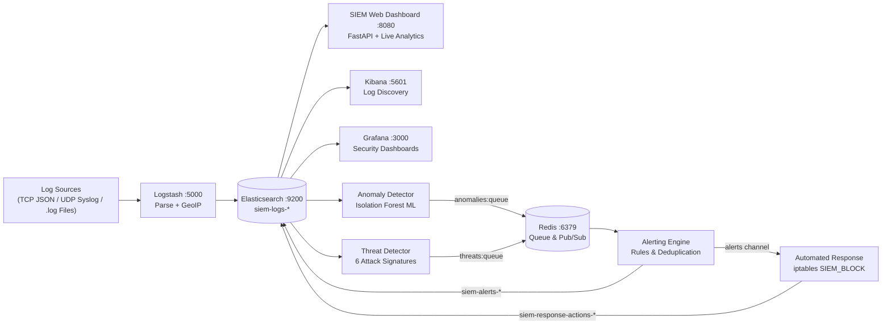

# 🛡️ AI-Powered SIEM: Real-Time Security Monitoring, Threat Intelligence & Anomaly Detection Platform

[](docker-compose.yml)
[](elasticsearch/config/elasticsearch.yml)
[](kibana/config/kibana.yml)
[](logstash/pipeline/main.conf)
[](grafana/config/grafana.ini)
[](frontend/main.py)
[](docker-compose.yml)
[](anomaly-detection/main.py)

An end-to-end, containerized **Security Information and Event Management (SIEM)** platform built on the **ELK Stack**, **Grafana**, **Redis**, and **Python**. It combines centralized log ingestion, signature-based threat detection, **Isolation Forest** machine-learning anomaly detection, deduplicated alerting, and **automated firewall response (`iptables`)** in a single `docker compose` stack.

---

## ✨ Key Capabilities

- **Centralized Log Ingestion** — Collects JSON over TCP (`5000`), Syslog over UDP (`5000`), and `.log` files (`/var/log/siem/*.log`) via Logstash with GeoIP enrichment.
- **ML-Driven Anomaly Detection** — Trains an `IsolationForest` model (`scikit-learn` + `StandardScaler`) on historical traffic to flag statistical outliers in near real time.
- **Signature-Based Threat Detection** — Continuously correlates events in Elasticsearch for Brute Force, Port Scans, DDoS, Privilege Escalation, Malware, and Data Exfiltration.
- **Real-Time Alerting & Deduplication** — Routes and deduplicates alerts over Redis pub/sub and queues with configurable severity rules (`email`, `slack`, `sms` hooks).
- **Automated Incident Response (SOAR)** — Listens on the Redis `alerts` channel and automatically blocks high/critical attacker IPs and ports using an `iptables` `SIEM_BLOCK` chain.
- **Custom SOC Web Dashboard (`:8080`)** — Clean light-themed FastAPI + Chart.js web console for real-time KPIs, threat & anomaly graphs, SOAR blocked IPs, alert feeds, and Lucene raw log search with 30s auto-refresh.
- **Interactive Security Dashboards** — Visualizes logs, threats, anomalies, and response actions in **Kibana** and **Grafana**.

---

## 🏗️ System Architecture



---

## 🧩 Stack Components

| Service | Container | Purpose | Port / Access |
|---|---|---|---|
| **Frontend Dashboard** | `ai-siem-frontend` | Light-themed SOC web UI & FastAPI proxy | [`http://localhost:8080`](http://localhost:8080) |
| **Elasticsearch** | `ai-siem-elasticsearch` | Search engine & security data lake | [`http://localhost:9200`](http://localhost:9200) |
| **Kibana** | `ai-siem-kibana` | Log exploration & visualization | [`http://localhost:5601`](http://localhost:5601) |
| **Logstash** | `ai-siem-logstash` | Log parsing, GeoIP & indexing pipeline | `5000` (TCP/UDP), API `:9600` |
| **Grafana** | `ai-siem-grafana` | Security overview dashboards | [`http://localhost:3000`](http://localhost:3000) |
| **Redis** | `ai-siem-redis` | Message queues & alert pub/sub | `6379` |
| **Anomaly Detector** | `ai-siem-anomaly-detector` | `IsolationForest` ML outlier engine | Internal |
| **Threat Detector** | `ai-siem-threat-detector` | Signature & correlation engine | Internal |
| **Alerting Engine** | `ai-siem-alerting` | Rule evaluation & 300s deduplication | Internal |
| **Automated Response** | `ai-siem-response` | Automated IP/port blocking (`iptables`) | Internal (`NET_ADMIN`) |

---

## 🔍 Detection & Automated Response Matrix

| Detection Type | Trigger / Method | Severity | Automated Response |
|---|---|---|---|
| **Brute Force Login** | ≥ 5 `authentication_failed` events in 10m | `high` | Blocks source IP (60 min default) |
| **Port Scanning** | ≥ 20 `connection_attempt` events in 5m | `medium` | Blocks targeted port (30 min, when `dst_port` is present) |
| **DDoS Attack** | ≥ 1,000 `http_request` events in 1m | `critical` | Blocks source IP (120 min) + targeted port (30 min) |
| **Privilege Escalation** | ≥ 3 `privilege_escalation` events in 15m | `critical` | Blocks source IP (120 min) |
| **Malware Signature** | ≥ 1 `malware_detected` event in 1m | `critical` | Blocks source IP (120 min) |
| **Data Exfiltration** | ≥ 500 `data_transfer` events in 5m | `critical` | Blocks source IP (120 min) |
| **ML Behavioral Anomaly** | `IsolationForest` (`contamination=0.1`) | `high` / `medium` | Queued to Redis & alerted |

---

## 🚀 Quick Start

### Prerequisites
- **Docker** & **Docker Compose**
- **4+ GB RAM** and **20+ GB free disk space**
- **Python 3.8+** (for host-side test scripts and CLI client)

### 1. Prepare Data Directories
```bash
mkdir -p elasticsearch/data redis/data logs sample-data
```

### 2. Start the Stack
```bash
docker compose up -d --build
```
*(Or run `./quick-start.sh` on Linux/macOS.)*

### 3. Verify All Services
```bash
docker compose ps
```
> All core services (`elasticsearch`, `kibana`, `logstash`, `grafana`, `redis`) should report `Up (healthy)`, and the four Python engines should report `Up`.

### 4. Open Dashboards
| Interface | URL | Default Credentials |
|---|---|---|
| **SIEM Web Dashboard** | http://localhost:8080 | No auth (direct SOC UI) |
| **Kibana** | http://localhost:5601 | `elastic` / `change_me_elastic_password` |
| **Grafana** | http://localhost:3000 | `admin` / `change_me_grafana_password` |
| **Elasticsearch** | http://localhost:9200 | No auth locally (`xpack.security.enabled: false`) |
| **Logstash Monitoring** | http://localhost:9600 | No auth |

> ⚠️ **Security Note:** Change the placeholder passwords (`change_me_elastic_password`, `change_me_grafana_password`, `change_me_redis_password`) in [docker-compose.yml](docker-compose.yml) before deploying outside localhost.

---

## 🖥️ Web Dashboard (`http://localhost:8080`)

Built with **FastAPI**, **Jinja2**, and **Chart.js** ([`frontend/main.py`](frontend/main.py), [`frontend/templates/index.html`](frontend/templates/index.html)):

- **Live KPI Cards** — Total Logs, Threats Detected, Blocked Attacks, and Cluster Uptime/Status.
- **Graph Analyzers** — Threat Overview dual-line chart (Normal vs. Anomalies), Severity Distribution doughnut, Anomaly Score Trend, and Threat Types breakdown.
- **Live Feeds & Tables** — Recent Alerts, Threat Intelligence Feed, Anomaly Detection Feed, and SOAR Automated Response / Blocked IPs.
- **System Pipeline & Quick Actions** — Visualizes `Ingestion → Storage → Detection → Response` with one-click analysis refresh.
- **Raw Log Search** — Query `siem-logs-*` directly using Lucene syntax (e.g., `event_type:"authentication_failed"` or `src_ip:"192.168.1.50"`).
- **Auto-Refresh** — Automatically polls Elasticsearch every 30 seconds with selectable time ranges (`1h`, `6h`, `24h`, `7d`).

---

## 🧪 Simulating Attacks & Testing

Generate realistic baseline traffic and multi-vector attack scenarios directly into Logstash (`localhost:5000`):

```bash
# Run full simulation (normal baseline + brute force + port scan + exfil + DDoS + escalation)
python sample-data/generate_logs.py --scenario full

# Or run targeted scenarios
python sample-data/generate_logs.py --scenario normal --count 50
python sample-data/generate_logs.py --scenario bruteforce --count 8
python sample-data/generate_logs.py --scenario portscan --count 25
python sample-data/generate_logs.py --scenario ddos --count 10
```

Test automated firewall blocking:
```bash
python test_blocking.py
docker exec ai-siem-response iptables -L SIEM_BLOCK -n -v
```

---

## 💻 CLI Client & Operations

Query Elasticsearch indices and cluster health using [siem-client.py](siem-client.py):

```bash
python siem-client.py --command stats
python siem-client.py --command alerts --hours 24
python siem-client.py --command threats --hours 24 --severity high
python siem-client.py --command anomalies --hours 24
python siem-client.py --command high-severity --hours 24
```

Common Docker operations:
```bash
docker compose logs -f threat-detector anomaly-detector alerting-engine automated-response
docker compose stop
docker compose start
docker compose down
```

---

## 📁 Project Structure

```text
SIEM/
├── docker-compose.yml              # 10-service SIEM orchestration
├── frontend/                       # FastAPI + Chart.js SOC Web Dashboard (:8080)
│   ├── Dockerfile
│   ├── main.py                     # Elasticsearch proxy API & template server
│   ├── requirements.txt
│   └── templates/index.html        # Light-themed SOC dashboard UI
├── siem-client.py                  # Python CLI for querying alerts, threats & stats
├── test_blocking.py                # Automated response test suite
├── quick-start.sh                  # Automated Linux/macOS startup script
├── health-check.sh                 # Service & endpoint verification script
├── elasticsearch/config/           # Single-node ES config & disk watermarks
├── kibana/config/                  # Kibana configuration
├── logstash/
│   ├── config/logstash.yml         # Logstash runtime settings
│   └── pipeline/main.conf          # TCP/UDP/File inputs, GeoIP & ES output
├── grafana/
│   ├── config/grafana.ini          # Grafana settings
│   ├── dashboards/                 # Security Overview dashboard JSON
│   └── provisioning/               # Auto-provisioned ES datasource & dashboards
├── anomaly-detection/              # Isolation Forest ML service
├── threat-detection/               # 6-pattern threat correlation service
├── alerting/                       # Alert rules (alert_rules.yml) & deduplication
├── automated-response/             # Automated iptables IP/port blocker
└── sample-data/generate_logs.py    # Multi-scenario security event generator
```

---

## 📚 Additional Documentation

- [START_HERE.md](START_HERE.md) — Implementation overview and deliverables
- [ARCHITECTURE.md](ARCHITECTURE.md) — Deep dive into data flow, Redis queues, and ML pipeline
- [DEPLOYMENT.md](DEPLOYMENT.md) — Production setup and credential hardening
- [TESTING.md](TESTING.md) & [TESTING_AUTO_RESPONSE.md](TESTING_AUTO_RESPONSE.md) — Validation procedures
- [QUICK_START_BLOCKING.md](QUICK_START_BLOCKING.md) — Automated IP/port blocking guide
- [QUICKREF.md](QUICKREF.md) — Command cheat sheet
